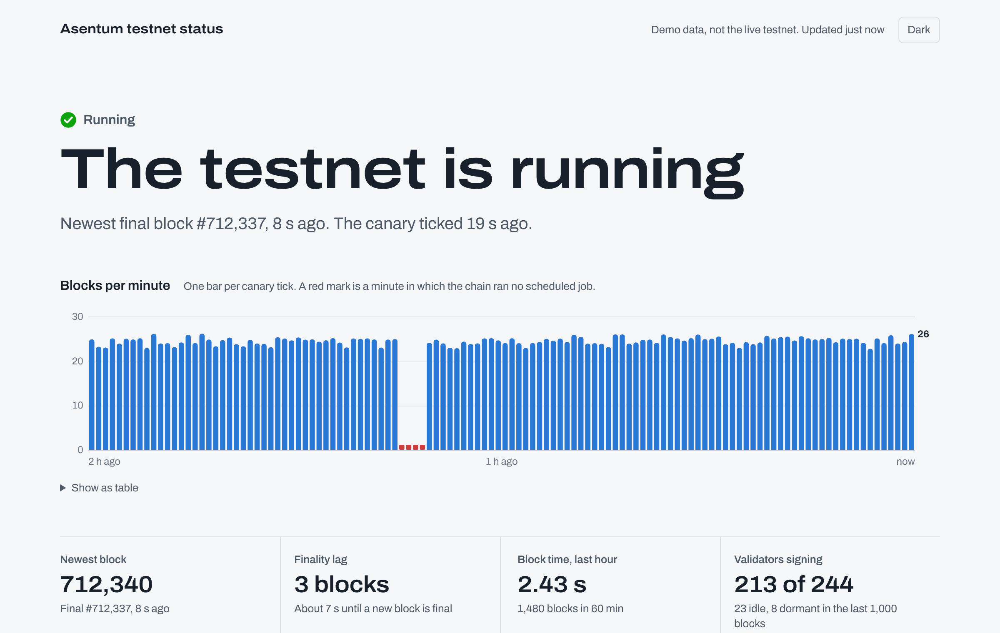

# Asentum testnet status

A community status page for the Asentum testnet. It answers one question
quickly: **is the testnet working right now, and if my node has trouble, is it
my node or the network?**

A static page on GitHub Pages reads everything straight from the chain in your
browser: block signatures from the node API, plus two small JavaScript
contracts. There is no server and no database.



## How it works

**The canary** (`contracts/canary.js`) is called once a minute by the chain's
own cron registry (ARC-21). Each tick records the block time and height. A
missing tick means the chain ran no scheduled job that minute; a gap of three
minutes or more is kept as a stall. Nobody has to keep a bot running: if the
ticks stop, the chain stopped.

**Block signatures.** Each epoch a committee of 100 validators (by stake)
produces blocks and casts finality votes. The node API reports who signed what
(`/participation`, `/consensus/liveness`), so every committee validator is
tracked automatically: signing, idle, missing votes. Nobody has to install
anything for that.

**The operator registry** (`contracts/heartbeat-registry.js`) adds what
signatures can't:

- **Names.** An operator registers once and their validator shows with a name
  instead of a bare address. One name per validator.
- **Heartbeats (optional).** A tiny `beat` transaction every few minutes from
  the node's machine. Useful for validators outside the committee, which sign
  nothing and are otherwise invisible, and for anyone who wants to know their
  node accepts and relays transactions. The contract keeps the last beat, the
  inclusion latency (block time minus the time the sender signed it) and 48
  hourly buckets for uptime.

**The page** (`site/`) shows the verdict, blocks per minute for the last two
hours, the last 48 hours of stalls and block times, and every validator with
its signature status, last signature and, if registered, name and heartbeat.

Reading it: if the canary is fine but your validator stops signing or your
heartbeat is late, look at your node. If the canary stalls, everybody is
affected.

## Layout

```
contracts/   heartbeat-registry.js, canary.js   (deployed as plain JS source)
site/        the status page (static; vendor/ holds the bundled @asentum/sdk)
sender/      heartbeat.mjs CLI and systemd unit, timer and env example
scripts/     keygen.mjs, deploy.mjs, check.mjs, shared helpers
test/        SES test runtime, contract tests, mock node, end-to-end tests
```

## Operators: name your validator

Your validator is on the page already if it is bonded. Registering adds your
name: one transaction from a small separate wallet (Node.js 18 or newer).

```sh
git clone https://github.com/Tom0092/asentum-status && cd asentum-status
npm ci --omit=dev
npm run hb -- keygen          # a new wallet just for this, never your validator key
#   -> send the printed address 0.1 test ASE (fees are 1 wei per gas today)
npm run hb -- register my-node --validator ase1... --no-heartbeat
```

Names are 3 to 24 characters (a-z, 0-9, `_`, `-`). A validator can carry one
name; `hb update --validator none` or `hb unregister` releases it.

## Operators: add a heartbeat (optional)

Worth it if your validator is outside the committee (it signs nothing, so the
page has no other signal), or if you want to know that your node accepts and
relays transactions. On the machine that runs your validator (Debian/Ubuntu
with systemd, Node.js 20 or newer):

```sh
# 1. Install
sudo useradd --system --home /var/lib/asentum-heartbeat --shell /usr/sbin/nologin asentum-hb
sudo git clone https://github.com/Tom0092/asentum-status /opt/asentum-status
cd /opt/asentum-status && sudo npm ci --omit=dev

# 2. Configure
sudo install -m 0640 -g asentum-hb sender/systemd/asentum-heartbeat.env.example /etc/asentum-heartbeat.env
sudo install -d -o asentum-hb -g asentum-hb -m 0700 /var/lib/asentum-heartbeat
alias hb='sudo -u asentum-hb node --env-file=/etc/asentum-heartbeat.env /opt/asentum-status/sender/heartbeat.mjs'

# 3. Wallet: a new key, never your validator key
hb keygen
#    -> send the printed address 0.1 test ASE

# 4. Register with a heartbeat interval (or switch an existing name-only
#    registration on with: hb update --interval 300)
hb register my-node --interval 300 --validator ase1...

# 5. Test one heartbeat, then start the timer
hb beat
sudo cp sender/systemd/asentum-heartbeat.{service,timer} /etc/systemd/system/
sudo systemctl daemon-reload
sudo systemctl enable --now asentum-heartbeat.timer
journalctl -u asentum-heartbeat -f
```

Other commands: `hb status`, `hb address`, `hb update --interval 600`,
`hb update --no-heartbeat`, `hb update --validator none`, `hb unregister`.

**Alerts.** Set `HB_ALERT_URL` in `/etc/asentum-heartbeat.env` to an ntfy
topic (or any webhook) to get one message when heartbeats start failing and
one when they recover.

**Testing your own node's transaction path.** By default the sender goes
through the public gateway. If your node serves the REST API locally, set
`HB_RPC` to it: then a stuck heartbeat means your node stopped accepting or
relaying transactions, even while it keeps signing blocks.

`beat` exit codes: 0 landed, 2 stuck (not in a block within `HB_TIMEOUT_MS`),
3 rejected by the node, 4 RPC unreachable, 5 failed in a block.

Keep the timer interval equal to the `--interval` you registered with. The
page counts a heartbeat as late after two missed intervals and offline after
six.

## Deploy (maintainers)

```sh
npm ci
npm run keygen                      # keys/deployer.json, git-ignored
# send the deployer about 2 test ASE (1 ASE becomes the canary's gas escrow)
npm run deploy -- --repo https://github.com/<you>/asentum-status
git add site/config.js && git commit -m "Point the page at the deployed contracts" && git push
```

`npm run check` shows the chain, the canary's ticks and escrow, and the
registry at any time.

`deploy.mjs` deploys and initializes both contracts, schedules `canary.tick`
every 60 s on the cron registry, records the job id on the canary and writes
the addresses into `site/config.js`. It keeps its progress in
`deploy-state.json`, so if anything times out, run it again and it continues.

Then in the repository settings: **Pages, Source: GitHub Actions**. The
`pages.yml` workflow publishes `site/` on every push to `main`.

**Canary escrow.** Each tick is paid from the escrow sent with `schedule`
(at 1 wei per gas, 1 ASE lasts practically forever). Anyone can add to it by
calling `topUp(jobId)` on the cron registry with ASE attached. The page says
when the canary stops ticking while blocks are still final.

**Moderation.** Names are public. The deployer key owns both
contracts and can call `removeOperator(address)` on the registry and
`transferOwnership(address)` on either contract.

## Development

```sh
npm test                            # contracts in an SES sandbox + end-to-end against a mock node
python3 -m http.server -d site 8000 # then open http://localhost:8000/?demo
npm run build:vendor                # rebuild site/vendor/asentum-sdk.js after an SDK upgrade
```

The test runtime (`test/runtime.mjs`) runs the contracts in a Hardened
JavaScript compartment with the documented globals (`storage`, `msg`, `chain`,
`emit`, `assert`), so `Date.now()`, `Math.random()` and changes to frozen
built-ins fail the same way they do on chain. The mock node
(`test/mock-node.mjs`) decodes the real signed transactions from
`@asentum/sdk`, derives the sender from the ML-DSA-65 key and runs the
contracts, so `deploy.mjs` and `heartbeat.mjs` are tested end to end.

The page accepts overrides in the URL: `?rpc=…&registry=…&canary=…`, and
`?demo` for made-up data.

## Limits

- Built against `@asentum/sdk` 0.2.0 and the Asentum docs as of October 2026.
  The testnet is young and its docs and behaviour still drift; the mock node
  follows the documented behaviour, not a live node.
- Latency is block time minus the sender's clock. Keep NTP running.
- Signature statuses (signing, idle, dormant) are the node's own
  classification from `/participation`; the page shows them as reported.
  Validators outside the committee sign nothing, so only a heartbeat shows
  them.
- Heartbeats show that a transaction from your machine lands. They don't
  replace your node's own metrics.
- A community project, not run by or affiliated with the Asentum team.

## License

MIT. The Archivo font in `site/fonts` is under the SIL Open Font License 1.1.
